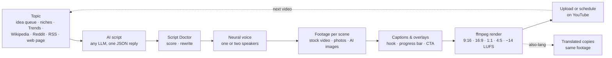

<div align="center">

# PurffleShorts — Free AI YouTube Shorts Generator & Upload Autopilot

**English** · [简体中文](https://github.com/Chamanrajragu/purffle-shorts/blob/main/README.zh-CN.md) · [Español](https://github.com/Chamanrajragu/purffle-shorts/blob/main/README.es.md) · [Português](https://github.com/Chamanrajragu/purffle-shorts/blob/main/README.pt-BR.md) · [हिन्दी](https://github.com/Chamanrajragu/purffle-shorts/blob/main/README.hi.md) · [日本語](https://github.com/Chamanrajragu/purffle-shorts/blob/main/README.ja.md)

**An open-source AI video generator for YouTube Shorts, TikTok and Instagram Reels. Give it a topic, a web page, a Reddit post or a long podcast, and it makes finished vertical videos (script, voiceover, footage, captions), then uploads or schedules them on YouTube.**<br>
It writes with the AI model you choose (GPT, Claude, Gemini, Llama through Ollama, DeepSeek, Grok, Mistral or any OpenAI-compatible API) and has a second AI pass grade and rewrite the script. Free neural voices read it (one or two speakers), stock footage or AI images illustrate every sentence, and the words appear as animated captions, a text-message screen or a Reddit-style post card. It renders with ffmpeg in 9:16, 16:9, 1:1 or 4:5, runs on your own computer, and also works from Claude Desktop, Claude Code and Cursor through MCP.

[](https://github.com/Chamanrajragu/purffle-shorts/actions/workflows/ci.yml)
[](https://python.org)
[](https://github.com/Chamanrajragu/purffle-shorts/blob/main/LICENSE)
[](https://github.com/Chamanrajragu/purffle-shorts/stargazers)
<br>
[](#-ai-models)
[](#%EF%B8%8F-voices)
[](#-formats)
[](#-publishing--scheduling)
[](#-use-it-from-claude-and-other-ai-apps-mcp)

[Features](#-features) · [Use cases](#-use-cases) · [Compare](#%EF%B8%8F-how-it-compares) · [Quick start](#-quick-start) · [Formats](#-formats) · [Clip long videos](#%EF%B8%8F-clip-long-videos-into-shorts) · [AI models](#-ai-models) · [Voices](#%EF%B8%8F-voices) · [Publishing](#-publishing--scheduling) · [Studio](#%EF%B8%8F-studio-web-app) · [MCP](#-use-it-from-claude-and-other-ai-apps-mcp) · [FAQ](#-faq)


<sub>Real output, no editing: <code>examples/flamingos.json</code>, <code>examples/dialogue.json</code> and <code>examples/chat-story.json</code> rendered with <code>make --script</code>.<br>
Free Microsoft neural voices, AI images from Pollinations (for the octopus videos they were downloaded one by one into a local folder first, because keyless Pollinations now allows about one image every few minutes). GIFs have no sound.</sub>

**Try it with no API keys and no sign-up** (needs [uv](https://docs.astral.sh/uv/)):

```bash
uvx --from git+https://github.com/Chamanrajragu/purffle-shorts purffle-shorts demo --style chat
```

**⭐ If PurffleShorts saves you time, a star helps other creators find it.** &nbsp;·&nbsp; 🌐 [purffle.com/purffle-shorts](https://purffle.com/purffle-shorts/)

<!-- mcp-name: io.github.Chamanrajragu/purffle-shorts -->

</div>

---

## 🤖 What is PurffleShorts?

PurffleShorts is a **YouTube Shorts production tool** for faceless channels. It can plan topics, draft and review scripts, generate narration and visuals, sync captions, and render a video locally. Every video remains a draft until you review and explicitly approve its upload or schedule.

Beyond draft production, it is a small studio: draft a script and edit any line before rendering, make **two-voice dialogues**, **text-message stories** and **Reddit-style stories**, turn an article or a Reddit post into a Short, **clip a podcast into Shorts** (an Opus Clip-style workflow that runs on your computer), prepare translations, plan ideas, and optionally use channel view counts to inform new scripts.

It is made for **content creators**, **faceless YouTube channels**, **educators** and **marketers** who want short-form video at volume without editing by hand. It runs on your own computer (macOS, Windows, Linux or Docker), you pick every model, and the vertical 9:16 MP4s work for **TikTok** and **Instagram Reels** too.

---

## 🎯 Use cases

- **A faceless channel production workflow.** Pick a niche (space, history, animals, money tips), plan ideas from available sources, and render drafts for human review. Similar recent titles are avoided; factual claims and citations still require independent verification before publication.
- **Text-message and Reddit-style story videos** for Shorts, TikTok and Reels: the AI writes a fictional chat or a first-person post, two voices or one narrator read it, and the chat screen or post card is animated for you. A Reddit post link works as the source too.
- **Podcast, interview and stream clips.** `clip episode.mp4 --count 5` transcribes the video, lets the AI pick the moments that stand on their own and returns captioned vertical clips, with no per-minute fees.
- **Articles, blog posts and notes into video.** `make --url https://…` or `--from-file notes.md` turns your own writing into a Short.
- **One idea, many languages.** `--also-lang es,hi,pt` publishes the same video with native voices in each language, reusing the footage.
- **Education and explainers.** Quiz, myth-vs-fact, explainer and dialogue formats, in 9:16 for Shorts or 16:9 for regular YouTube.
- **An AI assistant that makes videos.** Through MCP, ask Claude or Cursor to draft, render, clip or upload videos from a chat.

---

## ✨ Features

**AI scriptwriting**
- One structured LLM call returns the whole Short: hook, scenes, a footage search and an image prompt per scene, title, description, hashtags, tags and YouTube category.
- **Script Doctor**: a second AI pass scores the draft 0–100 for retention (hook, pacing, payoff, accuracy risk), lists what is weak and rewrites it. The score is stored with every video.
- **12 providers**: OpenAI, Anthropic Claude, Google Gemini, Groq, OpenRouter, DeepSeek, Mistral, Together AI, xAI Grok, Ollama, LM Studio, or any OpenAI-compatible URL. List backups in `LLM_FALLBACKS` and they are tried in order if the main one fails.
- **11 formats**: facts, story, listicle, myth-busting, quiz, explainer, motivational, news, **two-voice dialogue**, **text-message story** and **Reddit-style story** (a post card while the title is read, then the story with captions).
- Draft first and edit any line in the Studio, or write a script yourself and render it with `--script`, with no LLM call.

**Sources**
- Your niches, Google Trends, Wikipedia "On this day", Reddit TIL, **RSS feeds**, your own list, **any web page or Reddit post** (`--url`) or **document** (`--from-file`).
- **Content planner**: the AI brainstorms a batch of specific, non-repeating ideas into a queue that the autopilot uses first.
- **Clip long videos**: transcribe a podcast, interview or talk, let the AI pick the moments that stand alone, and get captioned vertical clips.

**Voiceover**
- 320+ free Microsoft neural voices in 75 languages, with word-level timestamps. No key needed.
- Two speakers for dialogues and chat stories, each with their own voice, joined with natural pauses.
- **One video, many languages**: `--also-lang es,hi` adds translated copies that reuse the same footage.
- Also OpenAI TTS, ElevenLabs, Kokoro-82M, Coqui and the operating-system voice. Falls back to the free voice if a paid engine fails.

**Footage & images**
- A separate stock-footage search for every scene (Pexels, Pixabay), portrait clips preferred, smart 9:16 crop, never reused across videos.
- AI images per scene from OpenAI (gpt-image-1 / DALL·E 3) or Pollinations, or your own `media/` folder.
- Ken Burns motion on photos, colour grades, transitions.

**Captions & editing**
- Captions appear exactly when each word is spoken, with the current word highlighted. 6 styles; Latin, Indic, Arabic, Thai and CJK scripts.
- Dialogues get speaker name tags and a colour per speaker; chat stories get an animated phone screen with typing indicators; Reddit-style stories open on a post card (community, poster, title, votes).
- **9:16, 16:9, 1:1 or 4:5** output (`--aspect`), with captions and overlays sized for each shape.
- Hook title, watermark, progress bar, end call-to-action, background music that ducks under the voice, loudness normalised to −14 LUFS.
- Plain ffmpeg: each scene is prepared as a short segment, then one final encode joins them and adds everything above. No MoviePy, no ImageMagick, no GPU.

**Publishing**
- Uploads to YouTube, or schedules each video into your next free time slot.
- Quota-aware queue, AI-content disclosure, playlists, privacy, made-for-kids flag.
- Every video also gets a cover image, SRT subtitles and a metadata file for cross-posting.

**Workflow**
- Autopilot loop, one-off videos, bulk batches with parallel workers, several channels from separate settings files.
- **Studio web app**: create, draft and edit, watch every stage live, browse and play the library, plan ideas, clip videos, read channel stats.
- **MCP server**: ask Claude Desktop, Claude Code or Cursor to make, clip or upload videos.
- **Learns from your channel** (opt-in): view counts of your uploads show the AI what works for your audience.
- Discord / Slack / webhook notifications, a `doctor` self-check, SQLite history, Docker, and CI that renders real videos on every pull request.

---

## ⚖️ How it compares

Open-source Shorts tools each cover part of the job: some write videos from a topic, some clip long videos, some make Reddit stories. PurffleShorts does all three, and it is the only one we found with text-message stories, two-voice dialogues, a script review pass and an MCP server that covers writing, clipping and uploading.

| | **PurffleShorts** | [MoneyPrinterTurbo](https://github.com/harry0703/MoneyPrinterTurbo) | [ShortGPT](https://github.com/RayVentura/ShortGPT) | [RedditVideoMakerBot](https://github.com/elebumm/RedditVideoMakerBot) | [AI-Youtube-Shorts-Generator](https://github.com/Anil-matcha/AI-Youtube-Shorts-Generator) | [OpenShorts](https://github.com/mutonby/openshorts) |
|---|:-:|:-:|:-:|:-:|:-:|:-:|
| Writes the video from a topic | ✅ | ✅ | ✅ | ❌ Reddit threads | ❌ clipper | ➖ paid APIs |
| Any LLM, including local Ollama | ✅ | ✅ | ➖ OpenAI, Gemini | ❌ no LLM | ➖ OpenAI, Gemini | ✅ |
| Free voices, no key | ✅ | ✅ | ✅ | ✅ | ❌ no voice | ➖ ElevenLabs |
| Word-by-word highlighted captions | ✅ | ➖ | ❔ | ❌ | ❌ | ✅ |
| Script review and rewrite pass | ✅ | ❌ | ❌ | ❌ | ❌ | ❌ |
| Text-message chat stories | ✅ | ❌ | ❌ | ❌ | ❌ | ❌ |
| Two-voice dialogues | ✅ | ❔ | ❔ | ❌ | ❌ | ❌ |
| Reddit-style stories | ✅ | ❌ | ✅ | ✅ | ❌ | ❌ |
| Clip long videos into Shorts | ✅ | ❌ | ❌ | ❌ | ✅ | ✅ |
| Videos in other languages | ✅ | ✅ | ✅ | ✅ | ➖ | ✅ paid dubbing |
| YouTube upload and scheduling | ✅ official API | ➖ via Upload-Post, no scheduling | ❌ | ❌ by design | ❌ | ✅ via Upload-Post |
| TikTok / Instagram upload | ❌ files only | ✅ via Upload-Post | ❌ | ❌ | ❌ | ✅ via Upload-Post |
| MCP server | ✅ | ❌ | ❌ | ❌ | ❌ | ✅ clipping |
| Web app | ✅ | ✅ | ✅ | ➖ settings only | ❌ | ✅ |
| Tests and CI | ✅ | ✅ | ❌ | ➖ lint only | ❌ | ✅ |
| License | MIT | MIT | MIT | GPL-3.0 | MIT | MIT |

<sub>✅ yes · ➖ partly · ❌ no · ❔ not stated. Compiled on 29 September 2026 from each project's README and code. Projects change quickly: if a cell is wrong, please <a href="https://github.com/Chamanrajragu/purffle-shorts/issues">open an issue</a> and it will be fixed. Where others are ahead: MoneyPrinterTurbo and OpenShorts can post to TikTok and Instagram through the Upload-Post service, and MoneyPrinterTurbo has a one-click Windows package and a Colab notebook.</sub>

---

## 📸 Screenshots

**New in 3.0: text-message stories, two-voice dialogues and Reddit-style stories.** Rendered from [`examples/chat-story.json`](https://github.com/Chamanrajragu/purffle-shorts/blob/main/examples/chat-story.json), [`examples/dialogue.json`](https://github.com/Chamanrajragu/purffle-shorts/blob/main/examples/dialogue.json) and [`examples/reddit-story.json`](https://github.com/Chamanrajragu/purffle-shorts/blob/main/examples/reddit-story.json).

<p align="center"></p>

**Frames from the flamingo Short above**: hook title, word-highlighted captions, progress bar, end call-to-action.

<p align="center"></p>

**Six caption styles**, drawn by the same renderer the videos use:

<p align="center"></p>

**Studio**, the local web app: pick a format, shape and look, then draft the script or create the video.

<p align="center"></p>

The library: every video with its format, language, length and status. Open one to play it, edit and re-render it, upload or delete it.

<p align="center"></p>

**Command line**: `doctor` checks the setup, `make` renders a Short.

<p align="center"></p>

---

## 🆕 What's new in 3.0

| | 2.0 | 3.0 |
|---|---|---|
| Script quality | One LLM call | **Script Doctor**: a second pass scores retention 0–100, lists the problems and rewrites weak lines. You can also draft first and edit every line in the Studio |
| Formats | 8, one narrator | **11**, including **two-voice dialogues** (name tags, colour per speaker), **text-message stories** (animated phone screen, typing indicator) and **Reddit-style stories** (post card, then captions) |
| Sources | Niches, Trends, Wikipedia, Reddit, your list | Also **any web page or Reddit post** (`--url`), **documents** (`--from-file`), **RSS feeds**, and an **AI content planner** with an idea queue |
| Long videos | — | **`clip`**: transcribe a podcast or talk, the AI picks self-contained moments, vertical crop or blurred fit, word captions |
| Languages | One per video | **`--also-lang es,hi`**: translated copies of the same video that reuse its footage |
| Shapes | 9:16 | **9:16, 16:9, 1:1, 4:5** with sizes that adapt (`--aspect`) |
| Channel feedback | — | **Learns from stats** (opt-in): the best and worst performers are shown to the AI when it writes |
| Web app | A form and a list | **New Studio**: live stage progress, script editor, library with player and actions, ideas, clipping, channel stats, setup checks. Works on phones |
| Integrations | — | **MCP server** for Claude Desktop, Claude Code and Cursor; Discord / Slack / webhook notifications |
| Reliability | | Clear errors for bad settings, hardware-encoder fallback to libx264, failed videos return their idea to the queue, database migrates itself, installs cleanly on Intel Macs, 120+ tests, Docker build checked in CI |

<details>
<summary><b>What changed in 2.0</b> (the rewrite from 1.x)</summary>

Version 2 is a rewrite. The 1.x pipeline had problems: the pinned `openai` SDK no longer had the API the code called, landscape footage was stretched into portrait, captions were evenly spaced rather than following the voice, the title and description were generated separately from the script, and every video went through six MoviePy re-encodes.

| | 1.x | 2.0 |
|---|---|---|
| Script | GPT-3.5, 4 separate calls, title unrelated to script | **One structured call**: hook, scenes, per-scene footage queries, title, description, hashtags, tags, category |
| Models | OpenAI only | **OpenAI, Claude, Gemini, Groq, OpenRouter, DeepSeek, Mistral, Together, xAI, Ollama, LM Studio, any OpenAI-compatible URL**, with optional fallbacks |
| Voice | Coqui Tacotron2 (robotic, heavy) | **Free Microsoft neural voices** (320+, 75 languages) + OpenAI, ElevenLabs, Kokoro, Coqui, system voice |
| Captions | Even time slices, no sync | **Word-accurate timing**, active-word highlight, pop-in animation, 6 styles |
| Footage | Same query for every clip, landscape stretched to 9:16 | **A search per scene**, portrait-first, smart 9:16 crop, never reused across videos, Ken Burns on photos, AI images optional |
| Render | MoviePy + ImageMagick, 6 encodes at 60 fps | **ffmpeg only**, one final encode, transitions, colour grades, progress bar. A 25 s Short rendered in 30–40 s on an Intel Mac in testing |
| Audio | Music at a fixed volume | **Music auto-ducks under the voice**, loudness normalised to −14 LUFS |
| Publishing | Always public, burns quota | **Schedule into time slots**, privacy options, AI-content disclosure, playlists, quota-aware queue |
| Ideas | 22 hard-coded categories, repeats | **Niches, Google Trends, Wikipedia "On this day", Reddit TIL, your own list**, with repeats prevented |
| Extras | — | Web dashboard, `doctor` self-check, history DB, SRT subtitles, cover image, `--script` for your own scripts, Docker, CI with an offline end-to-end render test |

</details>

---

## 🔄 How it works



| Step | What happens |
|------|-------------|
| 1. **Topic** | Queued ideas first, then your niches, today's Google Trends, Wikipedia "On this day", Reddit TIL (best-effort, since Reddit rate-limits anonymous requests) or `topics.txt`, skipping anything already made and news about deaths, violence or elections |
| 2. **Script** | The LLM writes a hook-first script split into scenes, each with its own stock-footage query and AI-image prompt, plus title, description, hashtags, tags and category, all in one JSON reply. With `LEARN_FROM_STATS`, your best and worst performers are part of the prompt |
| 3. **Review** | The Script Doctor scores it for retention and rewrites weak lines (`SCRIPT_REVIEW=rewrite`, the default). A rewrite that misses the target length is ignored; if two bounded reviews still score below the configured threshold, rendering stops with a clear error |
| 4. **Voice** | Neural TTS speaks the script and returns per-word timestamps (or they are aligned/estimated). Dialogues and chats are voiced line by line with two voices |
| 5. **Footage** | Each scene gets its own clip: Pexels / Pixabay video (portrait preferred), photos with Ken Burns motion, your own `media/` folder, or AI images, with an animated gradient as the last resort |
| 6. **Captions** | 2–3-word captions appear exactly when spoken, with the current word highlighted; chat stories show messages popping in on a phone screen instead, and Reddit-style stories open on a post card |
| 7. **Render** | Scenes are cover-cropped to the output shape, colour-graded and joined with transitions; hook title, watermark, progress bar, end CTA, ducked music and −14 LUFS loudness are added in one final ffmpeg encode |
| 8. **Review & publish** | Review the generated video and metadata, then individually approve a YouTube upload or schedule; drafts are not auto-published |

---

## 🚀 Quick start

**Needs:** Python 3.10+. ffmpeg is used if installed; if not, the bundled `imageio-ffmpeg` binary is used. ImageMagick is no longer needed.

**Fastest:** with [uv](https://docs.astral.sh/uv/) installed, run it straight from GitHub without cloning anything:

```bash
uvx --from git+https://github.com/Chamanrajragu/purffle-shorts purffle-shorts demo
```

**To keep it and configure it**, clone and install:

```bash
git clone https://github.com/Chamanrajragu/purffle-shorts.git
cd purffle-shorts
python -m venv venv && source venv/bin/activate      # Windows: venv\Scripts\activate
pip install -e .                                     # or: pip install -r requirements.txt
```

**1. See it work with no keys at all.** This renders a sample Short with a built-in script, a free neural voice and generated backgrounds:

```bash
python -m purffle_shorts demo
python -m purffle_shorts demo --style chat        # text-message story
python -m purffle_shorts demo --style dialogue    # two voices
python -m purffle_shorts demo --style reddit      # Reddit-style story with a post card
```

Or open the web app and click through it (demo mode is on until you add a key):

```bash
python -m purffle_shorts studio
```

**2. Configure.** Copy `.env.example` to `.env`, add **one** LLM key (or run Ollama) and a Pexels and/or Pixabay key (both free), then run the self-check:

```bash
python -m purffle_shorts doctor
```

**3. Make one video** (kept locally, not uploaded):

```bash
python -m purffle_shorts make --topic "why octopuses have three hearts" --no-upload
```

**4. Connect YouTube once.** Create an OAuth client of type *Desktop app* in Google Cloud Console with the YouTube Data API v3 enabled, save it as `credentials.json`, then:

```bash
python -m purffle_shorts auth
```

**5. Autopilot:**

```bash
python -m purffle_shorts plan --count 14   # optional: queue two weeks of ideas first
python -m purffle_shorts run               # or the old way:  python YT.py
```

**Optional extras:** `pip install -e ".[clip]"` adds faster-whisper and yt-dlp for [clipping long videos](#%EF%B8%8F-clip-long-videos-into-shorts).

---

## 💬 Formats

Pick one with `SCRIPT_STYLE` / `--style`, or leave it on `auto`.

| Format | What you get |
|---|---|
| `facts` · `story` · `listicle` · `myth` · `quiz` · `explainer` · `motivational` · `news` | One narrator, footage per scene, word-highlighted captions |
| `dialogue` | Two people talking: A asks or doubts, B answers with specifics. Each line is voiced with its own voice (`TTS_VOICE` and `TTS_VOICE_B`, or automatic), captions carry the speaker's name and colour |
| `chat` | A text-message story: messages pop into a phone screen as they are read aloud, the contact's replies get a typing indicator, the chat scrolls when it fills up. Each side has its own voice |
| `reddit` | A first-person story told like a Reddit post: a post card (community, poster, title, votes) is shown while the title is read, then the story plays with word captions. Written by the AI as fiction, or adapted from a post you link with `--url` |

```bash
purffle-shorts make --style chat --topic "a babysitter gets texts from an unknown number"
purffle-shorts make --style dialogue --topic "why the sky is blue"
purffle-shorts make --style reddit --topic "a neighbour who keeps borrowing my ladder"
purffle-shorts make --url "https://www.reddit.com/r/tifu/comments/…"   # a real post as the source
```

Scripts from the LLM are fiction for `chat` and `reddit` (the prompt forbids real people). Reddit story videos usually play over gameplay or "satisfying" clips: put yours in `media/` and set `VISUAL_SOURCES=local`. Reddit post links are read through the post's public feed; only reuse posts when you have the author's permission. As with every format, read before you publish.

---

## ✂️ Clip long videos into Shorts

```bash
pip install faster-whisper                          # free, local transcription (or set OPENAI_API_KEY)
purffle-shorts clip podcast.mp4 --count 3           # fill the frame
purffle-shorts clip talk.mp4 --count 5 --crop blur  # whole picture over a blurred copy
purffle-shorts clip "https://…" --count 3           # URLs need: pip install yt-dlp
```

It works like Opus Clip or Vidyo.ai, but locally and without per-minute fees. The video is transcribed with word timings, and the LLM reads the timestamped transcript and picks moments of 20–58 s (`--min-seconds`, `--max-seconds`) that open with a hook and end on a complete thought, with a title, hashtags and a retention score for each. Each clip is cut on sentence boundaries, cropped to 9:16, captioned word by word with a hook title, and loudness-normalised. Without an LLM it still works, with moments spread evenly over the video instead. Clips are rendered as drafts; review and publish each one separately with `upload --id N`. Only clip videos you own or have permission to reuse.

---

## 🗓️ Ideas, sources and languages

- **Plan ahead:** `purffle-shorts plan --count 14 --niche "space"` asks the AI for specific, non-repeating ideas with a format and an angle each. `ideas` lists the queue (`--add`, `--remove`, `--clear`). Queued ideas are always made first; if a video fails, its idea goes back in the queue.
- **From a web page, a Reddit post or a document:** `make --url https://…` or `make --from-file notes.md` uses the text as the script's source material. A Reddit post link picks the Reddit story format automatically.
- **RSS:** `RSS_FEEDS=https://…/feed.xml,https://…` and `TOPIC_SOURCES=niche:3,rss:1`.
- **Many languages:** `ALSO_LANGUAGES=es,hi` (or `--also-lang`) makes a translated copy of every video with a native voice, reusing the original's footage. Each copy is its own upload, linked to the original in the library.

---

## 📊 Learn from your channel

```bash
LEARN_FROM_STATS=true
YOUTUBE_API_KEY=...        # optional: reads public stats without asking for more OAuth access
```

`purffle-shorts stats` (and the Studio's Channel page) can read view, like and comment counts of uploaded videos. With `LEARN_FROM_STATS=true`, new ideas may be informed by this data. Without `YOUTUBE_API_KEY`, run `auth` again to grant read access.

The existing YouTube OAuth integration does not request the YouTube Analytics API scope, so retention metrics are never assumed to be available automatically. To import a YouTube Studio CSV export with a `Video ID` column, run:

```bash
purffle-shorts analytics-import path/to/analytics.csv
```

Available views, likes, subscribers gained, stayed-to-watch, average view duration, average percentage viewed, topic/category and duration metrics are stored locally in `data/history.db`. When at least three imported videos have a metric, `LEARN_FROM_STATS=true` adds the channel's own median as descriptive context—not as a target—to future scripts.

To make imported metrics available to scheduled GitHub Actions runs, commit the updated `data/history.db` to `main`.

---

## 🧠 AI models

Set `LLM_PROVIDER` and `LLM_MODEL` in `.env`, or pass `--provider` / `--model`. With `LLM_PROVIDER=auto` the first key found is used, and a running Ollama is used when there is no key. `LLM_FALLBACKS=anthropic,gemini` retries with other providers when the main one fails. Any model a provider offers works; the defaults are only starting points.

| Provider | `LLM_PROVIDER` | Key | Default model |
|---|---|---|---|
| OpenAI | `openai` | `OPENAI_API_KEY` | `gpt-4o-mini` (GPT-5 / o-series supported) |
| Anthropic Claude | `anthropic` | `ANTHROPIC_API_KEY` | `claude-opus-5` (structured JSON output) |
| Google Gemini | `gemini` | `GEMINI_API_KEY` | `gemini-3.8-flash` |
| Groq | `groq` | `GROQ_API_KEY` | `llama-3.3-70b-versatile` |
| OpenRouter | `openrouter` | `OPENROUTER_API_KEY` | `openai/gpt-4o-mini`, or any of its hundreds of models |
| DeepSeek | `deepseek` | `DEEPSEEK_API_KEY` | `deepseek-chat` |
| Mistral | `mistral` | `MISTRAL_API_KEY` | `mistral-small-latest` |
| Together AI | `together` | `TOGETHER_API_KEY` | `meta-llama/Llama-3.3-70B-Instruct-Turbo` |
| xAI | `xai` | `XAI_API_KEY` | `grok-3-mini` |
| Ollama (local, free) | `ollama` | — | `llama3.1`, or the first model you have pulled |
| LM Studio (local, free) | `lmstudio` | — | whatever is loaded |
| Anything OpenAI-compatible | `custom` | `LLM_API_KEY` + `LLM_BASE_URL` | `LLM_MODEL` |

`python -m purffle_shorts providers` shows which providers have a key and whether Ollama / LM Studio are running.

**Script Doctor** (`SCRIPT_REVIEW`): `rewrite` (default) scores every script and uses the improved version, `score` only records the score and the problems, `off` skips review (`--no-review`). `SCRIPT_QUALITY_THRESHOLD` (default `70`, or `--quality-threshold`) sets the minimum score; rewrite mode makes at most one additional bounded review/rewrite when the score is lower. If the final valid score remains below threshold, the script is not rendered; lower the threshold or revise the script before rendering.

> **Facts need a capable model.** In testing, a 3B local model wrote a confident but wrong claim ("flamingos get their colour from carrots"). Use a larger model for fact-based formats, or check `script.json`, fix it, and re-render with `--script`.

---

## 🎙️ Voices

| Engine | `TTS_ENGINE` | Cost | Word timing |
|---|---|---|---|
| Microsoft neural voices (edge-tts) | `edge` *(default)* | Free, no key | Native |
| OpenAI `gpt-4o-mini-tts` / `tts-1-hd` | `openai` | Paid | Aligned or estimated |
| ElevenLabs | `elevenlabs` | Paid | Native |
| Kokoro-82M (open weights, local) | `kokoro` | Free, `pip install kokoro soundfile` | Aligned or estimated |
| Coqui TTS (local) | `coqui` | Free, `pip install coqui-tts` | Aligned or estimated |
| OS voice (`say` / espeak-ng / SAPI) | `system` | Free, offline | Estimated |

- `python -m purffle_shorts voices --lang en` lists the free voices for a language (322 voices in 75 languages when checked; try `--lang es`, `--lang hi` and so on). Set `TTS_VOICE=en-US-GuyNeural`, or a comma list to rotate voices between videos.
- `LANGUAGE=es` (or `hi`, `ta`, `fr`, `pt`, `ja`, …) switches the script, the voice and the caption font together. Tamil, Hindi, Arabic, Thai and similar scripts are rendered through libass so they are shaped correctly.
- `pip install faster-whisper` gives precise word timing for engines without native timestamps (`ALIGN=auto`).
- The second speaker in dialogues and chats uses `TTS_VOICE_B`, or a contrasting voice picked for the language.
- `TTS_PRONUNCIATIONS` fixes spoken terms without changing captions: `TTS_PRONUNCIATIONS="GPU=gee pee you;VRAM=vee ram"` (semicolon-separated `term=replacement`).
- If Edge TTS fails, the video logs the upstream error (including HTTP 403) and tries the free offline OS voice. Other engines retain their Edge fallback.

---

## 🎨 Captions & look

| Setting | Options |
|---|---|
| `CAPTION_STYLE` | `kinetic` (cream text, orange active word, dust exit) · `bold` · `boxed` (active word in a colour box) · `neon` (glow) · `clean` · `karaoke` · `minimal` |
| `CAPTION_POSITION` | `upper` · `center` · `lower` |
| `CAPTION_EXIT` | `auto` (dust for kinetic/bold) · `none` · `dust` · `dissolve`; tune with `CAPTION_EXIT_SECONDS`, or set `CAPTION_REDUCED_EFFECTS=true` on slower machines |
| `COLOR_GRADE` | `none` · `vivid` · `cinematic` · `warm` · `cool` · `bw` |
| `TRANSITION` | `random` · `none` · `fade` · `slideup` · `smoothleft` · `circleopen` · `zoomin` · … |
| Overlays | Hook title (`HOOK_OVERLAY`), watermark (`WATERMARK`, defaults to `CHANNEL_NAME`, which is PurffleStudios until you change it; `none` hides it), progress bar (`PROGRESS_BAR`), end call-to-action (`END_CTA`) |
| Music | Drop tracks in `music/` (a random one is picked per video; `back.mp3` still works); `MUSIC_VOLUME`, `MUSIC_DUCKING` |
| Shape | `ASPECT=9:16` (Shorts, Reels, TikTok) · `16:9` (regular YouTube video, no `#shorts`) · `1:1` · `4:5`, or an exact `RESOLUTION=1080x1920` |
| Output | `FPS=30`, `VIDEO_ENCODER=libx264` · `h264_videotoolbox` (Mac) · `h264_nvenc` (NVIDIA) · `auto` (a hardware encoder that fails falls back to libx264) |

The caption font is downloaded once from Google Fonts (Anton for Latin scripts, Noto Sans for other scripts). Set `CAPTION_FONT=/path/font.ttf` to use your own.

**Visual sources** (`VISUAL_SOURCES`, tried in order per scene): `pexels`, `pixabay`, `local` (your `media/` folder, matched by filename keywords), `openai-images` (gpt-image-1 / DALL·E 3), `pollinations` (AI images), `agnes` (Agnes AI image generation). Searches and AI images follow the output shape (portrait, landscape or square).

> **Agnes AI images:** set `AGNES_API_KEY` in your environment and add `agnes` to `VISUAL_SOURCES` (for example `VISUAL_SOURCES=agnes,pexels,pixabay`). The default model is `agnes-image-2.5-flash`; override it with `AGNES_IMAGE_MODEL`. Agnes requests use `https://apihub.agnes-ai.com/v1/images/generations`. Keep the API key private and out of source control. To check the endpoint without spending credits, run `python scripts/agnes_smoke.py`; add `--live` only when you intend to make one billable request.

If Agnes is unavailable or its key is missing, a diagnostic is logged and the next configured visual source is tried.

**Hybrid visuals:** `--visual-mode hybrid` keeps the stock-first rule for most scenes but reserves every Nth scene (default: every second scene, starting with scene 2) for a topic-specific AI image. Configure both a stock source and an AI source, for example `VISUAL_SOURCES=pixabay,agnes` (or `--visuals pixabay,agnes`). Use `HYBRID_IMAGE_EVERY` / `--hybrid-image-every` to change the interval (minimum 2). If the AI provider is missing or fails, that scene falls back to stock footage and the log says so. The default `VISUAL_MODE=auto` preserves the previous stock-first behaviour.

> **Pollinations without a key is no longer practical for whole videos.** Tested on 29 September 2026: the first request returned an image, the next ones answered HTTP 402 "payment required", roughly one image every few minutes. When that happens PurffleShorts stops asking for the rest of that video and those scenes fall back to the next source. `POLLINATIONS_API_KEY` is sent as a Bearer token for keyed access; that path has not been tested here. Pexels and Pixabay keys are free and are the dependable choice.

---

## 📅 Publishing & scheduling

- **Review is the default.** `make`, `run`, and `daily` generate local drafts and do not publish, even if a legacy `UPLOAD=true` setting remains. `upload --id N` displays the video, script, captions, metadata, factual/rights warnings and quality checks, then requires you to type `PUBLISH` for that specific video. `upload --pending` applies the same review individually to each queued/rendered item. No unattended bulk publication is enabled.
- `upload --id N --dry-run` (or `upload --pending --dry-run`) performs the local review and quality checks without recording approval, uploading, or scheduling.
- `YT_PRIVACY=public|unlisted|private`.
- `PUBLISH_TIMES=09:00,14:00,19:00` with `TIMEZONE=Asia/Kolkata` proposes the next available time slot. If configured, the review summary displays that time before the upload request; YouTube's API schedules the video as private. Without publish times, the configured visibility is used for immediate publication.
- **Paced and quota-aware.** `YT_DAILY_LIMIT=6` is a local safety limit, not a guarantee of API quota. Videos exceeding it remain queued. Publishing them requires another per-video review with `upload --pending`.
- `SYNTHETIC_MEDIA=true` sets YouTube's *altered or synthetic content* disclosure. `MADE_FOR_KIDS`, `PLAYLIST_ID` and category (chosen by the AI) are set too.
- Each video's folder holds `short.mp4` (`video.mp4` for 16:9), `cover.jpg`, `captions.srt`, `script.json` and `metadata.json` (including the retention score). Factual warnings require human verification; the AI review score is not a fact check. `KEEP_VIDEOS=false` deletes the MP4 after a successful upload.
- **Notifications:** `NOTIFY_WEBHOOK=https://discord.com/api/webhooks/…` (or a Slack incoming webhook, or any URL for JSON) posts a message when a video is rendered, uploaded, scheduled, queued or fails.

---

## 💻 Command line

```bash
python -m purffle_shorts <command> [options]        # or `purffle-shorts <command>` after pip install
```

| Command | What it does |
|---|---|
| `run` | Autopilot loop. `--count N`, `--once`, `--batch`, `--workers`, `--delay` |
| `make` | Make one video now. `--topic "…"`, `--url https://…` (web page or Reddit post), `--from-file notes.md`, `--count N`, `--script file.json` (your own script, no LLM) |
| `demo` | Render a sample with no API keys (`--style chat`, `dialogue` or `reddit` for the story formats) |
| `clip` | Cut a long video into Shorts: `clip talk.mp4 --count 3 --crop center\|blur` |
| `plan` / `ideas` | Let the AI plan ideas into the queue / list, add or remove queued ideas |
| `stats` | Refresh and show view counts of your uploads |
| `mcp` | Run as an MCP server for Claude Desktop, Claude Code, Cursor… |
| `upload` | `--pending` uploads rendered and queued videos, up to today's `YT_DAILY_LIMIT`; `--id N` uploads one |
| `auth` | Connect your YouTube channel |
| `doctor` | Check ffmpeg and libass, LLM (including whether the Ollama model is pulled), voices, keys, footage sources, YouTube setup |
| `providers` / `voices` | List LLM providers / free voices |
| `history` | Everything made so far, with links |
| `studio` | Local web app |

Common options: `--source queue|trending|wikipedia|reddit|rss|file|niche`, `--niche "space"`, `--style facts|story|listicle|myth|quiz|explainer|motivational|news|dialogue|chat|reddit`, `--lang`, `--duration 30`, `--aspect 9:16|16:9|1:1|4:5`, `--also-lang es,hi`, `--provider`, `--model`, `--no-review`, `--tts`, `--voice`, `--voice-b`, `--visuals`, `--caption-style`, `--grade`, `--transition`, `--resolution`, `--no-music`, `--no-upload`, `--privacy`, `--publish-times`, `--env-file`.

**Your own script:** every video folder has a `script.json`. Edit the narration, title or image prompts and render it again with `make --script path/to/script.json`. The files in [`examples/`](https://github.com/Chamanrajragu/purffle-shorts/tree/main/examples) show the format.

**Several channels:** keep one settings file per channel (niche, voice, `YT_TOKEN_FILE`, `DATA_DIR`) and run `python -m purffle_shorts run --env-file .env.channel2`.

**Upgrading from 1.x:** `python YT.py`, `--once`, `--no-upload`, `--count N` and the old `SHORTS_*` variables still work, and `token.pickle` is migrated to `token.json` automatically. Install the new requirements first.

---

## 🖥️ Studio (web app)

```bash
python -m purffle_shorts studio        # opens http://127.0.0.1:8765
```

- **Create:** topic, web page, idea queue or "surprise me"; eleven formats; language, length, aspect, voices, caption style (with a preview), grade, transitions, footage sources, model, Script Doctor mode, extra languages, upload.
- **Draft, then edit:** the AI writes and reviews the script, you see the retention score and the problems it found, change any line, reorder or add scenes, switch speakers, then render exactly that script.
- **Live progress** through topic, script, review, voice, footage, captions, render and upload, with the log.
- **Library:** thumbnails with status, format, language and score; open one to play it, download the MP4 or captions, upload it, edit and re-render it, or delete it.
- **Ideas, Clip, Channel and System** pages: plan and queue ideas, clip long videos, see views per video and per format, run the setup checks and copy the MCP config.

It needs no build step or internet connection (no CDN), listens on localhost only, refuses requests for any other host name, sends a strict Content-Security-Policy, and every action needs a per-session token.

---

## 🤖 Use it from Claude and other AI apps (MCP)

PurffleShorts is an [MCP](https://modelcontextprotocol.io) server too. Add it to Claude Desktop, Claude Code, Cursor or any MCP client:

```json
{
  "mcpServers": {
    "purffle-shorts": {
      "command": "purffle-shorts",
      "args": ["mcp"],
      "env": { "PURFFLE_HOME": "/path/to/your/purffle/folder" }
    }
  }
}
```

Without installing anything, `uv` can run it straight from GitHub: use `"command": "uvx"` with `"args": ["--from", "git+https://github.com/Chamanrajragu/purffle-shorts", "purffle-shorts", "mcp"]`.

`PURFFLE_HOME` is the folder with your `.env`. Then ask things like *"make a 30-second text story about a haunted smart speaker, in Spanish"*, *"draft a dialogue about black holes and show me the script first"*, *"clip my interview.mp4 into three Shorts"* or *"plan ten ideas about ancient Rome"*. Tools: `make_short`, `draft_script`, `clip_video`, `plan_ideas`, `list_videos`, `upload_video`. Nothing is uploaded unless the request says so (`upload: true`); `demo: true` works without any keys.

---

## 🐳 Docker

```bash
docker build -t purffle-shorts .
docker run --rm -it --env-file .env -v "$PWD:/work" purffle-shorts run
```

Run `auth` once on your own computer so `token.json` exists in the mounted folder. For the Studio in Docker, publish the port on localhost only: `docker run --rm -it --env-file .env -v "$PWD:/work" -p 127.0.0.1:8765:8765 purffle-shorts studio --host 0.0.0.0 --no-browser`. Keep comments in `.env` on their own lines: `--env-file` reads a comment after a value as part of the value.

---

## ❓ FAQ

**Is PurffleShorts free?**<br>
Yes. It is MIT-licensed and runs on your own computer. The default voices, Ollama models, faster-whisper and the Pexels and Pixabay APIs cost nothing. You only pay for paid APIs you choose to use, such as OpenAI, Claude or ElevenLabs. The Script Doctor normally adds one LLM call and can add one more when a rewrite-mode score is below its threshold (`SCRIPT_REVIEW=off` to skip review).

**Can it make text-message stories, Reddit story videos or two-person conversations?**<br>
Yes: `--style chat` renders an animated phone screen with messages popping in as each side's voice reads them, `--style reddit` opens on a Reddit-style post card and then tells the story with captions, and `--style dialogue` voices two people with name tags on the captions.

**Is there a free, open-source alternative to Opus Clip?**<br>
`purffle-shorts clip` does the same job on your own computer: it transcribes a podcast, interview or stream, lets an LLM (a local Ollama model works) pick self-contained moments, and cuts captioned 9:16 clips. There are no per-minute credits, and the only watermark is your channel name from `CHANNEL_NAME` (it reads PurffleStudios until you set it; `WATERMARK=none` removes it). It crops to the centre (or fits the whole picture over a blurred copy); it does not track faces.

**How is it different from MoneyPrinterTurbo or ShortGPT?**<br>
All three turn a topic into a Short. PurffleShorts adds a script review pass, text-message, dialogue and Reddit-style formats, long-video clipping, scheduled uploads through the official YouTube API, and an MCP server. See the [comparison table](#%EF%B8%8F-how-it-compares) for the details and where the others are ahead.

**Can Claude or another AI assistant make YouTube Shorts with this?**<br>
Yes, through MCP: add PurffleShorts to an MCP client that runs local servers, such as Claude Desktop, Claude Code or Cursor ([setup](#-use-it-from-claude-and-other-ai-apps-mcp)). Ask for a video in plain words and it writes, renders and, only if you ask, uploads it.

**Can it turn my podcast or stream into Shorts?**<br>
Yes: `purffle-shorts clip episode.mp4 --count 5 --no-upload` (leave out `--no-upload` to upload the clips too). It needs faster-whisper (free, local) or an OpenAI key for the transcript.

**Can I try it without an API key?**<br>
Yes. `python -m purffle_shorts demo` renders a sample Short with no keys. With [Ollama](https://ollama.com) installed, `make` writes scripts with a local model, also without a key.

**Does it work with ChatGPT, Claude, Gemini, DeepSeek or Llama?**<br>
Yes: OpenAI GPT models (including GPT-5 and the o-series), Anthropic Claude, Google Gemini, DeepSeek, Mistral, xAI Grok, Llama through Groq, Together AI, Ollama or LM Studio, hundreds more through OpenRouter, and any OpenAI-compatible endpoint.

**Can it post to TikTok or Instagram Reels?**<br>
It uploads to YouTube only. Every video is a standard MP4 (9:16, or 1:1 / 4:5 for feeds) with a cover image, subtitles and metadata, so you can post the same file to TikTok and Reels yourself.

**How many Shorts can it upload per day?**<br>
Six by default (`YT_DAILY_LIMIT`), as a local pacing limit. Actual API quota depends on the Google Cloud project and can change. Videos over the local limit remain queued for later manual review.

**Can I write or fix the script myself?**<br>
Yes. Edit any video's `script.json` (or write one like [`examples/flamingos.json`](https://github.com/Chamanrajragu/purffle-shorts/blob/main/examples/flamingos.json)) and run `make --script file.json`.

**Which languages are supported?**<br>
Set `LANGUAGE` (for example `es`, `hi`, `ta`, `ar`, `ja`) and the script, voice and caption font follow. The free voices cover 75 languages. `ALSO_LANGUAGES=es,hi` publishes every video in those languages too.

**Do I need a GPU?**<br>
No. Rendering uses ffmpeg on the CPU. A GPU only speeds up optional local models (Ollama, Kokoro, faster-whisper).

**Is automated uploading allowed?**<br>
It uses the official YouTube Data API with your own Google sign-in, and sets YouTube's synthetic-content disclosure for you. You are responsible for what you publish: review the videos and follow YouTube's policies, including its monetisation rules on mass-produced, repetitive content.

---

## 🏗️ Tech stack

| Component | Technology |
|---|---|
| Script | Any LLM: OpenAI-compatible HTTP, plus the Anthropic SDK with structured outputs; a review pass and translation on the same providers |
| Voice | edge-tts, OpenAI, ElevenLabs, Kokoro, Coqui, OS voices; multi-speaker joining; optional faster-whisper alignment |
| Video | ffmpeg (xfade, zoompan, sidechaincompress, loudnorm, libass), Pillow caption, chat and post-card renderers |
| Media | Pexels, Pixabay, local files, OpenAI Images, Pollinations; yt-dlp for clipping from URLs |
| Upload | YouTube Data API v3, OAuth 2.0, resumable uploads, view statistics |
| Studio | Python standard-library HTTP server, vanilla JS/CSS, no build step |
| Agents | MCP over stdio (standard library, no SDK) |
| State | SQLite history (videos, topics, clips, uploads, schedule, idea queue, stats), migrated automatically |

---

## 📁 Project structure

```
purffle-shorts/
├── YT.py                    # 1.x-compatible entry point (python YT.py)
├── purffle_shorts/
│   ├── cli.py               # commands: run, make, demo, clip, plan, ideas, stats, upload, auth, doctor, studio, mcp
│   ├── pipeline.py          # topic → script → review → voice → footage → render → upload → translations
│   ├── llm.py               # 12 LLM providers + fallback chain
│   ├── script.py            # prompt, JSON schema, Script Doctor, translation, clean-up, offline writer
│   ├── planner.py           # AI content planner → idea queue
│   ├── clipper.py           # long video → transcript → best moments → captioned clips
│   ├── tts.py               # voice engines, two-speaker joining, word alignment
│   ├── timing.py            # word timing, scene timeline, caption chunks, SRT
│   ├── media.py             # Pexels / Pixabay / local / AI images, de-duplication
│   ├── overlays.py          # captions (Pillow + libass), chat screen, post card, hook, watermark, CTA, fonts
│   ├── render.py            # ffmpeg segments, transitions, grading, audio mix
│   ├── youtube.py           # OAuth, upload, scheduling, quota
│   ├── analytics.py         # view counts → what the LLM learns from
│   ├── notify.py            # Discord / Slack / webhook messages
│   ├── topics.py            # idea queue, niches, Trends, Wikipedia, Reddit, RSS, web pages, Reddit posts, documents
│   ├── history.py           # SQLite history + migrations
│   ├── doctor.py            # setup checks (CLI and Studio)
│   ├── mcp_server.py        # MCP server over stdio
│   ├── studio.py            # local web app server + JSON API
│   └── web/                 # the Studio's HTML, CSS and JS
├── examples/                # ready-to-render scripts (make --script examples/flamingos.json)
├── tests/                   # unit + offline end-to-end render tests
├── docs/                    # screenshots
├── .env.example             # the main settings, documented
├── Dockerfile
└── output_videos/           # renders (gitignored)
```

---

## 🛠️ Troubleshooting

| Problem | Fix |
|---|---|
| `No LLM is configured` | Add one key to `.env` (or start Ollama), then run `doctor` |
| `ollama model '…' is not pulled` | `ollama pull <model>`, or leave `LLM_MODEL` empty to use a model you already have |
| Every scene is a gradient | Add `PEXELS_API_KEY` / `PIXABAY_API_KEY` (both free) or put clips in `media/` |
| Pollinations returns HTTP 402 | Keyless use is now limited to about one image every few minutes. PurffleShorts skips it for the rest of that video; set `POLLINATIONS_API_KEY` or use Pexels/Pixabay |
| `clip` says it needs a transcript | `pip install faster-whisper` (or set `OPENAI_API_KEY`); URLs also need `pip install yt-dlp` |
| `Setting problem: X='…'` | A number setting in `.env` has a typo; the message names it and its default |
| `YouTube is not authorized` | Run `python -m purffle_shorts auth` |
| Videos stay `queued` | Your `YT_DAILY_LIMIT` or one of YouTube's limits was reached. Review and retry them with `upload --pending` when the limit clears. |
| A video failed and the log is too short | Run with `-v` for full tracebacks (also written to `data/logs/purffle.log`) |
| Wrong-looking non-Latin captions | Install an ffmpeg with libass (Homebrew and apt builds include it); `doctor` shows whether yours has it |

---

## 🤝 Contributing

Bug reports, ideas and pull requests are welcome. See [CONTRIBUTING.md](https://github.com/Chamanrajragu/purffle-shorts/blob/main/CONTRIBUTING.md) for the dev setup (tests run offline and render a real video), and [CHANGELOG.md](https://github.com/Chamanrajragu/purffle-shorts/blob/main/CHANGELOG.md) for what changed. Questions and ideas are welcome in [Discussions](https://github.com/Chamanrajragu/purffle-shorts/discussions) once they are enabled, or as an issue.

---

## ⚠️ Disclaimer

> This is an open-source automation tool for educational purposes. It needs your own API keys. Review AI-generated content before publishing, keep the synthetic-media disclosure on, and follow YouTube's Terms of Service and Community Guidelines. Not affiliated with YouTube, OpenAI, Anthropic, Google, Microsoft, Pexels, Pixabay, Pollinations or Reddit.

---

<div align="center">

**Built by [Chaman Raj](https://github.com/Chamanrajragu)**

Part of the **Purffle** ecosystem — PurffleTools · PurffleAI · [Purffle.com](https://purffle.com)

</div>


---

<!-- purffle-ecosystem -->
## 🧩 The Purffle toolset

**PurffleShorts** is part of **[Purffle](https://purffle.com)** — a growing set of free, open-source tools built in the open. **If this saved you time, please drop a ⭐ — it genuinely helps the project reach more people!**

| Tool | What it does |
|------|--------------|
| 🔄 **[Claude Multi](https://github.com/Chamanrajragu/claude-multi)** | Run Claude Code with multiple accounts — auto-switch on the 5-hour limit |
| 📐 **[Purffle Chartwright](https://purffle.com/purffle-chartwright/)** | Desktop chart analysis where the AI cannot invent a price |
| 🎵 **[PurffleGrab](https://github.com/Chamanrajragu/purffle-grab)** | Free Spotify & YouTube downloader — MP3, MP4, 4K |
| 🎥 **[PurffleVision](https://github.com/Chamanrajragu/purffle-vision)** | AI video creation — any topic to a finished video |
| ⚡ **[PurffleShorts](https://github.com/Chamanrajragu/purffle-shorts)** 👈 | Autonomous YouTube Shorts generator |
| 📈 **[PurffleTrader](https://github.com/Chamanrajragu/purffle-trader)** | Crypto paper-trading bot — Binance, EMA + RSI |
| 🤖 **[PurffleCopyBot](https://github.com/Chamanrajragu/purffle-copybot)** | Copy-trading bot — mirror top Hyperliquid traders |

<sub>🌐 [purffle.com](https://purffle.com) · 💼 by [Chaman Raj](https://github.com/Chamanrajragu) · ⭐ Star to support open-source</sub>

---

## Need Something Like This Built for You?

I wrote this. I also write Python for other people — fixed price, agreed before I start.

- **Python automation** — batch file processing, Excel/CSV cleaning, API pulls, scheduled reports, packaged as a `.exe` if you do not use Python · *1–5 days*
- **Web scraping** — clean data as Excel, CSV, JSON or Sheets, plus the reusable scraper · *1–4 days*
- **Custom AI chatbots** — trained on your own docs, full source code, no monthly fee · *2–7 days*
- **Excel and Google Sheets** — formulas, dashboards, macros, Apps Script · *1–4 days*

I only take work I can verify myself before delivering it — I run it on your real data first.

[](https://www.fiverr.com/purffle)
[](mailto:info@purffle.com)

More of what I have built: [purffle.com](https://purffle.com) · [purffle.tools](https://purffle.tools) · [purffleai.com](https://purffleai.com) · [purfflestudios.com](https://purfflestudios.com)
